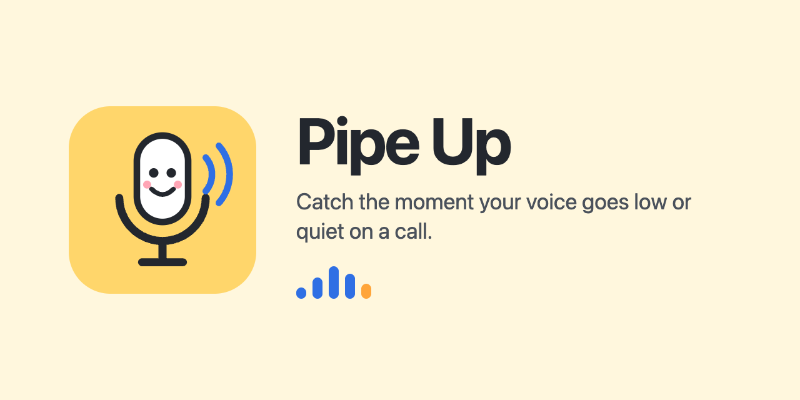

<p align="center"></p>

Pipe Up helps you catch the moment your voice goes low or quiet on a call, while it's
happening, instead of finding out later when someone says they couldn't hear you.

It learns what your voice normally sounds like through your mic and quietly shows
when your level drops well below that, whether you've drifted from the mic, an
app has turned your input down, or the mic has switched or gone silent. It's a
low-key indicator, not a nag. What you do with it is up to you. An optional
**expert diagnostics** mode helps work out *why* the level dropped.

Audio is never recorded or sent anywhere. Only the level is measured.

There are two versions:

| | `mac/`: native menu bar app | `web/`: no-install browser version |
|---|---|---|
| Install | Build once (needs Xcode command line tools) | Nothing. Open a web page |
| Lives in | Menu bar icon with live level bar | Small mini window (always-on-top in Chrome/Edge) |
| When your level drops | Icon turns orange + "Low", click-through pill under the menu bar (works over full-screen Zoom/Teams) | Mini window turns orange, tab title + favicon change, optional notification/beep |
| Sees macOS input volume changes | ✅ alerts when an app lowers it, can lock it | ❌ (you still see the resulting level drop) |
| Detects mic switching (e.g. AirPods take over) | ✅ | ✅ (when using "System default") |
| Expert diagnostics (why did it drop?) | ✅ full: gain vs distance vs muffled, input volume, which apps use the mic, Bluetooth call mode | ✅ partial: gain vs distance vs muffled, mic switch |

## Why your level might suddenly drop

- **Auto-gain in Zoom / Teams / Meet** lowers your macOS input volume. The Mac
  app spots this, and *Lock input volume* puts it back automatically.
- **The mic switched**: Bluetooth headphones connected and became the input,
  or a USB headset was unplugged and the laptop mic took over.
- **Position**: turning away from a laptop mic or a boom mic that has drifted.
- **Muted / dead mic**: hardware mute switch, bad cable, or macOS input mute.

---

## Mac app (`mac/`)

### Build and install

```bash
xcode-select --install        # once, if you don't have the command line tools
cd mac
./build.sh --install          # builds, copies to /Applications, launches
```

`./build.sh` on its own just builds `mac/build/Pipe Up.app`.

On first launch macOS asks for microphone access. Allow it. A mic icon with
a small level bar appears in the menu bar.

### Using it

- **Normal**: plain mic icon; the bar moves as you talk.
- **Calibrating**: for the first ~8 seconds of talking it learns your normal level.
- **Level dropped**: the icon turns orange with **"Low"** and an orange pill
  ("Your voice level has dropped −11 dB") appears at the top of the screen. It goes
  away as soon as you're back to normal.
- **Silent / muted**: the icon turns red and a red pill says the mic is picking up nothing.
- **Drag the pill** to move it out of the way. It remembers where you put it; double-click
  it (or use **Reset on-screen alert position**) to put it back. Hover and click **×** to
  dismiss it: it stays hidden until that alert clears, and comes back next time.

Click the icon for:

- a 60-second graph of your level, your speaking level, your normal level and the alert line
  (click it, or press ⌘H, to open the **history window**)
- **Open data folder (CSV)**
- the current mic and a **macOS input volume slider**
- **Lock input volume**: if any app changes it, it's put straight back
- **Re-learn my normal level** (use after changing mic or seating position)
- sensitivity (6 / 8 / 10 / 12 dB drop), on-screen alert (and resetting its position), silent alert, sound, open at login
- **Expert** → **Diagnostics** (⌘D) and **Show likely cause in alerts**

### History window

A resizable window with a time range picker (**1m · 5m · 15m · 1h · 4h · 24h**), a
**Keep on top** option so you can leave it in a corner during a call, and a legend.
Instead of plotting every second (which is spiky), it summarises your speaking level
over a sliding window (6 s at 1m, 20 s at 5m, 90 s at 1h, about 36 min at 24h):

- **Trend**: solid blue line, the median of your speaking level
- **Typical range**: darker blue band, the middle 50% of your speaking level
- **Full range**: lighter blue band, 10th to 90th percentile
- **Normal** (dashed) and **Alert line** (dotted orange)
- **Background**: grey area along the bottom, the room/mic noise level
- **Dropped / Silent**: orange or red shading with a strip along the top
- gaps: the app wasn't running
- **Show raw level** brings back the per-second detail if you want it

The trend and bands are joined up across pauses (but not across times the app wasn't
running), and the y-axis zooms to fit your actual levels, so a quiet mic still fills
the graph.

The small graph in the menu (now larger) uses the same bands, joined-up trend and auto-zoom over the last minute.

Hover to read exact values at any moment. The footer summarises the visible range:
number of quiet alerts, time spent quiet or silent, time talking and average speaking level.
The last 24 hours are reloaded when the app starts.

### Expert diagnostics: why did my level drop?

Optional, under **Expert** in the menu. Each time your level drops, Pipe Up looks at
the evidence and names the most likely cause:

| Finding | What it saw | Usually means |
|---|---|---|
| **input volume lowered** | macOS input volume is lower than when your normal level was learnt, plus the apps that were using the mic at that moment | Zoom/Teams/Meet auto-gain turned you down. Turn it off in the app, or use *Lock input volume* |
| **gain dropped** | your voice *and* the background noise fell by about the same amount | something in the signal chain turned down: auto-gain, a headset or interface gain knob, a different mic |
| **further from mic / softer** | your voice fell but the background stayed the same | you moved back, turned your head, or are talking more softly |
| **mic muffled / turned away** | your voice lost treble compared with normal | mic pointing away from your mouth, or covered (hand, collar, mask, headset boom moved) |
| **gain + distance** | background fell, but less than your voice | a mix of the two above |
| **mic switched** / **mic format changed** | the input device changed, or its sample rate changed | headphones took over as the mic. On Bluetooth a sample rate change means call mode |
| **louder background** | background noise rose | your voice stands out less |

The background can only be measured during pauses, so the diagnosis is re-checked every
few seconds while the drop lasts. The first guess may sharpen (e.g. from "gain + distance"
to "gain dropped") once you've paused.

- **Diagnostics window**: live readout of mic, transport (Bluetooth/USB/built-in), sample
  rate, input volume now and when your normal level was learnt, macOS Mic Mode, apps
  currently using the mic, and voice / background / brightness now vs normal. It also has
  the latest diagnosis, a **Check now** button ("why do I sound quiet right now?"), a
  running event log, and **Copy report** for pasting into a ticket or chat.
- **Show likely cause in alerts** adds it to the pill, e.g.
  "Your voice level has dropped (−11 dB) · likely: input volume lowered".
- Every diagnosis is written to `events.csv` as a `diagnosis` event, whether or not the
  expert options are on, so you can review causes later.

### Stored data (for your own analysis)

Everything is saved locally in `~/Library/Application Support/PipeUp/`:

- `history/YYYY-MM-DD.csv` has one row per second:
  `timestamp, epoch, level_db, peak_db, speech_db, normal_db, alert_line_db, state, input_volume, device, noise_floor_db, brightness_db`.
  `speech_db` and `brightness_db` are empty when you weren't talking. `state` is
  `calibrating`, `ok`, `quiet` (level dropped) or `silent`. `brightness_db` is treble
  relative to overall level; a fall means a duller, more muffled sound.
- `events.csv` holds the moments that matter: `state_quiet` (with how big the drop was),
  `diagnosis` (likely cause and evidence), `state_ok`, `state_silent`, `mic_switched`,
  `mic_sample_rate_changed`, `input_volume_lowered` (with the apps using the mic),
  `input_volume_restored`, `relearn_normal_level`, `app_started` and `app_quit`.

Only levels are stored, never audio. Daily files older than 90 days are deleted automatically.
A full day of continuous use is roughly 8 MB.

Quick look in a terminal: `grep ',quiet,' ~/Library/Application\ Support/PipeUp/history/$(date +%F).csv | wc -l`
gives the seconds you spent quiet today. Or open the CSVs in Numbers or Excel.

Notes:

- Requires macOS 13 or later.
- If you use AirPods for music only, note that any app reading the default mic
  (including this one) makes macOS use the AirPods mic, which switches them to
  lower-quality call audio. Pick a different input in Sound settings if that bothers you.
- The app is ad-hoc signed. If you rebuild it, macOS may ask for mic permission again.

---

## No-install version (`web/`)

A single HTML file. Nothing to install, so it works on a locked-down work laptop
(Mac or Windows).

**Option A: hosted (recommended).** Open
**https://twcollins.github.io/pipe-up/web/** in any modern browser (Chrome, Edge,
Firefox or Safari). The browser remembers the mic permission. In Safari, set the
site to "Allow" in Safari → Settings → Websites → Microphone, or it asks every visit.

**Option B: local file.** Download [`web/index.html`](web/index.html) and open it
in any modern browser.

Then:

1. Click **Start listening** and allow the microphone.
2. Click **Pop out mini window**. A small always-on-top window shows your
   level and turns orange when it drops. Put it in a corner near your camera.
3. Keep the original tab open. It can be in the background.

It measures the raw mic signal with the browser's echo cancellation, noise
suppression and auto-gain turned off, and it shares the mic happily with
Zoom/Teams/Meet. Optional extras: desktop notification and a soft beep (use the
beep only with headphones).

Tick **Expert: diagnose why my level dropped** for the same gain / distance / muffled /
mic-switch diagnosis as the Mac app. It adds a "Likely: …" line to the widget and a
Diagnostics panel with live numbers and a **Check now** button. The browser can't see your
computer's input volume or which apps use the mic, so those findings are Mac-only.

The always-on-top mini window uses Document Picture-in-Picture (Chrome/Edge 116+).
Firefox and Safari get a normal small pop-up window instead (allow pop-ups for the
page). It works the same but can go behind other windows.

---

## Icon

The "mic buddy" icon lives in `assets/`: `icon.svg` (flat, used by the README and web page),
`icon-macos.svg` (macOS icon grid with shadow, rendered into `mac/Resources/AppIcon.icns`),
`icon-512.png`, and `social-preview.png` (1280×640, for the GitHub repo's social preview).

## How detection works

Both versions use the same algorithm (`mac/Sources/Detector.swift`, and the
`Detector` class in `web/index.html`):

1. Measure RMS level (dBFS) roughly every 0.1 s.
2. Track the background **noise floor** (falls fast, rises slowly).
3. Treat frames clearly above the noise floor as **speech**.
4. Keep a short average of your speech (~1.5 s) and a long **baseline** (~45 s
   of speech). The first ~8 s of speech sets the initial baseline.
5. If the short average stays more than *N* dB (default 8) below the baseline for
   2 seconds **while you're talking**, alert. The alert clears with 2 dB of
   hysteresis, or after 6 s of not talking.
6. Near-zero signal (below −100 dBFS) for 3 s means the mic is silent or muted.
7. For diagnostics, also track the background noise and voice "brightness" (energy of
   the signal's first difference relative to its overall level) when your normal level
   is learnt, and compare them with the current values when a drop happens.

The baseline adapts slowly so it follows gradual changes, and adapts far more
slowly while you're quiet so it doesn't simply follow you down.
